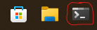
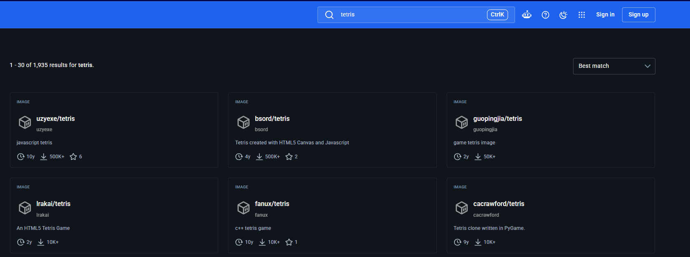

# Guide

In this challenge you will host your own minikube cluster and deploy a web application Docker image of your choice to it using Terraform and Helm. 

!!! tip "New to all this?"
    Each step explains what to run and why. If you get stuck, check the [Hints](hints.md). 
    
    If you're confident with these technologies, skip to [Contanerise a personal project](#containerise-a-personal-project)

## Accessing the challenge files

To complete the challenge you will need to open **Terminal**, this has been defaulted to launch into the **WSL terminal** when opened for the purpose of this challenge.



!!! info "Want to know what WSL is or need help?"
    [What is WSL?](https://learn.microsoft.com/en-us/windows/wsl/about)

    [WSL Hints](hints.md#wsl-basic-commands)

Once you've opened your terminal you need to navigate to the challenge directory(folder):
```shell
cd ~/UOPComputingChallenge
```

## What's in the challenge files

Below is the structure of the challenge files directory(folder):

```
├── helm/
│   └── challenge/        # Helm chart that packages the deployment and service
│       └── values.yaml   # <- you edit this (which image, which ports)
└── terraform/            # Terraform config that deploys the chart via Helm
    └── terraform.tfvars  # <- you edit this (deployment name, namespace)
```

- The **Helm chart** (`helm/challenge`) describes the Kubernetes resources: a `Deployment` running your image and a `NodePort` `Service` exposing it.
- **Terraform** (`terraform/`) uses the `helm_release` resource to install that chart onto your cluster. Terraform reads your kubeconfig (the `minikube` context) to know where to deploy.

Only two files need your input, and both are marked with `# EDIT VALUES IN THIS FILE` at the top.

## Starting your cluster

You'll start with launching your minikube cluster using the cli in terminal
```shell
minikube start
```

This creates a local single-node Kubernetes cluster and sets your kubeconfig context to `minikube`. Confirm it's up:
```shell
kubectl get nodes
```

Other `kubectl` commands to try:
```shell
kubectl cluster-info              # shows the addresses of the core cluster services
kubectl get namespaces            # lists the built-in namespaces
kubectl get pods -A               # lists every pod
kubectl get services -A           # lists all services
```

!!! tip
    `-A` shows resources from every namespace. Without it, `kubectl` only looks in the `default` namespace.

## Choosing an image

!!! info
    we recommend choosing a web application image for this as it will be simpler to deploy (less likely to need a large amount of memory or need alternative helm configuration)

You now need to decide in your group which Docker image you'd like to deploy to your minikube cluster using **Terraform** and **Helm**. New to these tools? See the [Software Overview](overview.md).

[Docker Hub](https://hub.docker.com/) is the primary public source for Docker images and any image you use today will likely be from there. However, being an industry focused service the ones it suggests on the homepage won't be very interesting to run outside of a microservice ecosystem.

Instead try the search feature to find an image that will deploy something accessible on it's own

For example, searching `tetris` takes me to results with multiple options to choose from:


Here are some search phrases to spark ideas:

- **Games:** `tetris`, `2048`, `snake`, `pacman`, `doom`, `minesweeper`, `chess`
- **Fun / demos:** `hello world`, `whoami`, `nyancat`, `ascii`, `clock`
- **Useful web tools:** `it-tools`, `code-server`, `nginx hello`, `httpbin`, `static site`
- **Dashboards / landing pages:** `homer`, `dashy`, `heimdall`, `linkding`

!!! info "What makes a good image for this challenge?"
    Look for images that serve a web page on a single port and don't need a database or extra services to start. The image's Docker Hub page should show a simple `docker run -p ...` example. If the description talks about needing a database or multiple containers, pick something simpler.

Whatever you pick, note three things from the image's Docker Hub page, you'll need them in the next step:

- The **image name** (e.g. `bsord/tetris`).
- The **tag** (e.g. `latest`).
- The **port** the app listens on inside the container (e.g. `80`).

!!! tip "Where do I find the port?"
    The Docker Hub page usually shows an example `docker run` command like
    `docker run -d -p 80:80 bsord/tetris`. In `-p SERVICE_PORT:CONTAINER_PORT`:

    - the number **after** the colon is the **container port**, the one your app
      listens on inside the container (this is `containerPort` later).
    - the number **before** the colon is the **service port** (this is
      `service.port` later). It's usually the same as the container port.

    So in `-p 80:80` both are `80`.

## Filling in your values

You must update the two files below with all the required values to successfully deploy your Docker image.

### `helm/challenge/values.yaml`

| Value | What to set it to |
| --- | --- |
| `image.repository` | Your chosen Docker image name. Example: `bsord/tetris` |
| `image.tag` | The image's tag. If you're unsure, set this to `latest` |
| `containerPort` | The container port you noted earlier, the one your app listens on inside the container, e.g. `80` |
| `service.port` | The service port you noted earlier. Usually the same as `containerPort` |
| `service.nodePort` | The port exposed on your machine. Must be a number in the 30000-32767 range, e.g. `30080` |

!!! warning "Replace the placeholder values"
    The file ships with placeholder values: `docker-hub-image`, `image-tag`, `containerPort: 9999`, `port: 8888` and `nodePort: 00000`. They all need to be updated or your deployment will fail.

### `terraform/terraform.tfvars`

| Value | What to set it to |
| --- | --- |
| `release_name` | A name for your deployment, e.g. `hello` |
| `namespace` | The namespace to deploy into, e.g. `hello-dev` |

!!! warning "Case sensitivity"
    For Terraform values you must use lowercase-letter, numbers, and dashes only
---

### Example

  Deploying [`bsord/tetris`](https://hub.docker.com/r/bsord/tetris), which listens on port `80`:

  ```yaml
  # helm/challenge/values.yaml
  image:
    repository: bsord/tetris
    tag: latest
  containerPort: 80
  service:
    port: 80
    nodePort: 30080
  ```

  ```hcl
  # terraform/terraform.tfvars
  release_name = "tetris"
  namespace    = "tetris-dev"
  ```

## Deploying with Terraform and Helm

Make sure `minikube` is running first (`minikube status`).

1. Move into the Terraform directory:
   ```shell
   cd terraform
   ```
2. Initialise Terraform (downloads the Helm provider):
   ```shell
   terraform init
   ```
3. Preview what will be created:
   ```shell
   terraform plan
   ```
4. Apply to deploy the chart:
   ```shell
   terraform apply
   ```
   Type `yes` when prompted. Terraform installs the Helm release and waits for
   the pod to become ready.

When it finishes, Terraform prints outputs including the command to open the app.

## Accessing the app

The chart exposes the app as a `NodePort` service. The easiest way to open it
on minikube is the `access_command` Terraform prints when it finishes. It looks
like this (using the `release_name` and `namespace` you set):
```shell
minikube service <release_name>-challenge -n <namespace>
```
For the example above (`release_name = "tetris"`, `namespace = "tetris-dev"`) that's:
```shell
minikube service tetris-challenge -n tetris-dev
```
This opens your browser to the running app. (The service is named `<release_name>-challenge` because Helm prefixes the chart name(**challenge**) with
your release name.)

Check the deployment status at any time:
```shell
kubectl get all -n <namespace>
```

## Tearing it down

Remove everything Terraform created (the Helm release, and the namespace):
```shell
terraform destroy
```
Type `yes` when prompted.

To shut down or delete the whole cluster:
```shell
minikube stop      # stop the cluster (keeps state)
minikube delete    # delete the whole cluster
```

## Extensions

Completed the previous steps or alredy confident with Docker? There are a couple things you could try now, the first continues on your challenge virtual machine and the second is for those looking to push into interacting with personal projects(requires personal device).

### Deploy Elastisearch
If you're choosing to continue on the virtual machine, you should now try to deploy the [Elastisearch Docker image](https://hub.docker.com/_/elasticsearch)

Follow the instructions again to update your **Helm** and **Terraform** files and deploy this image, then answer the questions below:

Did the image deploy successfully?

If it didn't then why?

What needs to be changed if this is failing to deploy successfully?

!!! tip "Extension hint"
    Use `kubectl` to attempt to diagnose the pods, what can you see in the events? What can be changed in the files to fix this?

### Containerise a personal project

!!! warning
    This extension task isn't recommnded unless you're already confident with these technologies or planning to complete this in your own time. These instructions also assume a higher level of understanding.

If you're confident with these technologies already then you should attempt to containerise either a personal web application project or a templated web application and push it to Docker Hub so that you can deploy it to your minikube cluster.

This will require you installing the technologies we've used onto a personal device, to do this on the challenge virtual machines we created this script which you can run from WSL(or terminal on Mac or Linux) - [setup script](https://github.com/WebOpsLR/UOPComputingChallenge/blob/main/install-tools.sh)

- Here is [Docker Hub's examample when containerising a Next.js application](https://docs.docker.com/guides/nextjs/)

As the focus of this challenge isn't specifically on the containerisation part of the deployment process, feel free to use an AI assistant to generate your Dockerfile and save you some time.

!!! tip
    If using a personal web application project then it's advised to push it to a private repository on Docker Hub.