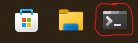
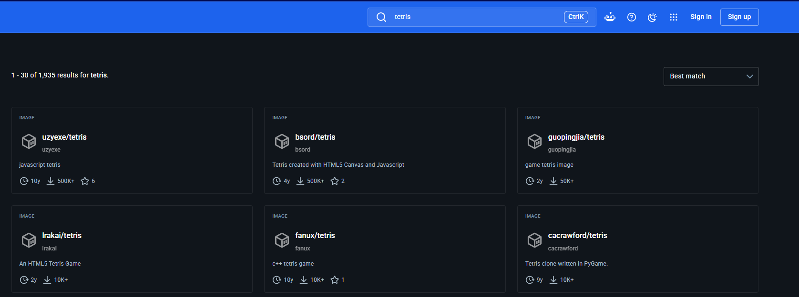

# Guide

In this challenge you will host your own minikube cluster and deploy a web application Docker image of your choice to it using Terraform and Helm. 

!!! tip "New to all this?"
    Each step explains what to run and why. If you get stuck, check the [Hints](hints.md). 
    
    If you're confident with these technologies, skip to [Contanerise a personal project](#containerise-a-personal-project)

## Accessing the challenge files

To complete the challenge you will need to open **Terminal**, this has been defaulted to launch into the **WSL terminal** when opened for the purpose of this challenge.



!!! info "Want to know what WSL is or need help?"
    [What is WSL?](https://learn.microsoft.com/en-us/windows/wsl/about)

    [WSL Hints](hints.md#wsl-basic-commands)

Once you've opened your terminal you need to navigate to the challenge directory(folder):
```shell
cd challenge/
```
Now you're in the right directory you can open the files in vscode
```shell
code .
```
You'll need to click the manage banner at the top of vscode and trust the workspace for the challenge.


!!! tip
    if you need to use `sudo` for anything, the username and password in WSL have both been set to **student**

## What's in the challenge files

Below is the structure of the challenge files directory(folder):

```
├── helm/
│   └── challenge/        # Helm chart that packages the deployment and service
│       └── values.yaml   # <- you edit this (which image, which ports)
└── terraform/            # Terraform config that deploys the chart via Helm
    └── terraform.tfvars  # <- you edit this (deployment name, namespace)
```

- The **Helm chart** (`helm/challenge`) describes the Kubernetes resources: a `Deployment` running your image and a `NodePort` `Service` exposing it.
- **Terraform** (`terraform/`) uses the `helm_release` resource to install that chart onto your cluster. Terraform reads your kubeconfig (the `minikube` context) to know where to deploy.

Only two files need your input, and both are marked with `# EDIT VALUES IN THIS FILE` at the top.

## Starting your cluster

!!! info
    Before trying to start your minikube cluster, you must ensure that you have opened the Docker desktop app and the Docker engine is running.

    To confirm if docker is running in terminal run `docker info`, this should output info on your Docker client.


You'll start with launching your minikube cluster using the cli in terminal
```shell
minikube start
```

This creates a local single-node Kubernetes cluster and sets your **kubeconfig** context to `minikube`. This can take up to a minute to become ready, so you may want to run the command multiple times to see when it's ready for deployments:
```shell
kubectl get nodes
```

Other `kubectl` commands to try:
```shell
kubectl cluster-info              # shows the addresses of the core cluster services
kubectl get namespaces            # lists the built-in namespaces
kubectl get pods -A               # lists every pod
kubectl get services -A           # lists all services
```

!!! tip
    `-A` shows resources from every namespace. Without it, `kubectl` only looks in the `default` namespace.

## Choosing an image

!!! info
    we recommend choosing a web application image for this as it will be simpler to deploy (less likely to need a large amount of memory or an alternative helm configuration)

You now need to decide in your group which Docker image you'd like to deploy to your Minikube cluster using **Terraform** and **Helm**. New to these tools? See the [Software Overview](overview.md).

[Docker Hub](https://hub.docker.com/) is the primary public source for Docker images and any image you use today will likely be from there. However, being an industry focused service the ones it suggests on the homepage won't be very interesting to run outside a microservice ecosystem.

Instead, try the search feature to find an image that will deploy something accessible on its own

For example, searching `tetris` takes me to results with multiple options to choose from:


Here are some search phrases to spark ideas:

- **Games:** `2048`, `snake`, `pacman`, `doom`, `minesweeper`, `chess`, `tetris`
- **Fun / demos:** `hello world`, `whoami`, `nyancat`, `ascii`, `clock`
- **Useful web tools:** `it-tools`, `code-server`, `nginx hello`, `httpbin`, `static site`
- **Dashboards / landing pages:** `homer`, `dashy`, `heimdall`, `linkding`

!!! info "What makes a good image for this challenge?"
    Look for images that serve a web page on a single port and don't need a database or extra services to start. The image's Docker Hub page should show a simple `docker run -p ...` example. If the description talks about needing a database or multiple containers, pick something simpler.

Whatever you pick, note three things from the image's Docker Hub page, you'll need them in the next step:

- The **image name** (e.g. `bsord/tetris`).
- The **tag** (e.g. `latest`).
- The **port** the app listens on inside the container (e.g. `80`).

!!! tip "Where do I find the port?"
    The Docker Hub page usually shows an example `docker run` command like
    `docker run -d -p 80:80 bsord/tetris`. In `-p SERVICE_PORT:CONTAINER_PORT`:

    - the number **after** the colon is the **container port**, the one your app
      listens on inside the container (this is `containerPort` later).
    - the number **before** the colon is the **service port** (this is
      `service.port` later). It's usually the same as the container port.

    So in `-p 80:80` both are `80`.

## Filling in your values

You must update the two files below with all the required values to successfully deploy your Docker image. Make sure you save your files as you go because vscode doesn't autosave by default.

### `helm/challenge/values.yaml`

| Value | What to set it to |
| --- | --- |
| `image.repository` | Your chosen Docker image name. Example: `bsord/tetris` |
| `image.tag` | The image's tag. If you're unsure, set this to `latest` |
| `containerPort` | The container port you noted earlier, the one your app listens on inside the container, e.g. `80` |
| `service.port` | The service port you noted earlier. Usually the same as **containerPort** |
| `service.nodePort` | The port exposed on your machine. Must be a number in the 30000-32767 range, e.g. `30080` |

!!! warning "Replace the placeholder values"
    The file ships with placeholder values: `docker-hub-image`, `image-tag`, `containerPort: 9999`, `port: 8888` and `nodePort: 00000`. They all need to be updated, or your deployment will fail.

### `terraform/terraform.tfvars`

| Value | What to set it to |
| --- | --- |
| `release_name` | A name for your deployment, e.g. `hello` |
| `namespace` | The namespace to deploy into, e.g. `hello-dev` |

!!! warning "Case sensitivity"
    For Terraform values you must use lowercase-letter, numbers, and dashes only
---

## Deploying with Terraform and Helm

Go back to your terminal for these steps as we're using the cli tools.

Make sure `minikube` is running first (`minikube status`).

1. Move into the Terraform directory:
   ```shell
   cd terraform
   ```
2. Initialise Terraform (downloads the Helm provider):
   ```shell
   terraform init
   ```
3. Preview what will be created:
   ```shell
   terraform plan
   ```
4. Apply to deploy the chart:
   ```shell
   terraform apply
   ```
   Type `yes` when prompted. Terraform installs the Helm release and waits for
   the pod to become ready.

When it finishes, Terraform prints outputs including the command to open the app.

!!! tip "Minikube Dashboard"
    You can use `minikube dashboard` in a new terminal window so running a kubernetes dashboard which allows you to visually see your namespace and deployment. You can select your namespace at the top (this is set to **default** on launch) and click around your deployment!

## Accessing the app

Open a new terminal window to access your application through minikube.

The chart exposes the app as a `NodePort` service. The easiest way to open it
on minikube is the `access_command` Terraform prints when it finishes. It looks
like this (using the `release_name` and `namespace` you set):
```shell
minikube service <release_name>-challenge -n <namespace>
```
This opens your browser to the running app. (The service is named `<release_name>-challenge` because Helm prefixes the chart name(**challenge**) with
your release name.)

!!! info "My service is opening a **connection refused** page"

    This is a common WSL issue, port-forwarding can be used as a workaround:
    ```shell
    kubectl port-forward -n <namespace> svc/<release_name>-challenge 8080:<service.port>
    ```

    Then visit <http://localhost:8080>.


Check the deployment status at any time:
```shell
kubectl get all -n <namespace>
```

## Tearing it down

!!! warning
    If you're attempting the Extension then complete that before running these steps.

Remove everything Terraform created (the Helm release, and the namespace):
```shell
terraform destroy
```
Type `yes` when prompted.

To shut down or delete the whole cluster:
```shell
minikube stop      # stop the cluster (keeps state)
minikube delete    # delete the whole cluster
```

## Extension

Completed the previous steps or already confident with Docker? We're going to attempt to deploy Jenkins to your minikube cluster using the same template you've used for your first image.

Jenkins is a real-world automation server, so it won't deploy quite like your first image. You'll be attempting to deploy the Jenkins image and troubleshooting any snags that may arise. 

### Deploy Jenkins

It's time to deploy the [Jenkins Docker Image](https://hub.docker.com/r/jenkins/jenkins).

Follow the [earlier steps](#filling-in-your-values) again to update your **Helm** and **Terraform** files for Jenkins, these all need to be updated to match your new deployment. Then run `terraform plan` to see the changes it's making before doing `terraform apply`.

### Monitor your deployment

Don't wait for `terraform apply` to finish, open a **new terminal** and watch what the pod does while it starts:

```shell
watch kubectl get pods -n <namespace>
```
Once you've spotted what's happening, use `Ctrl+C` to exit the watch view.

Now get the full details for that pod:

```shell
kubectl describe pod <pod> -n <namespace>
```

!!! info "Where to look in the output"
    - The **Events** section at the bottom of `describe` is where the first symptom shows up, read it top to bottom.
    - The **Containers** section (look at `Last State`, `Reason` and `Restart Count`) tells you what happened on the restarts.
    - Any error codes listed, what does a search of these return.

### Diagnose the deployment

Work through these questions with your group before changing anything:

- Did the image deploy successfully? If not, what state is the pod stuck in?
- What are the **Events** telling you? Is anything failing?
- Kubernetes is probing the container to decide if it's healthy. **Which port** is it checking, and is that the port Jenkins actually listens on?
- Jenkins is a large application, are the memory limits high enough?

!!! question "Liveness and readiness probes"
    The helm chart configures **liveness** and **readiness** probes, Kubernetes' way of asking "is this container alive?" and "is it ready for traffic?". When a probe keeps failing, Kubernetes restarts the container (You can see this in events). Have a read of what these should look like for a Jenkins deployment [Liveness, Readiness and Startup Probes](https://www.jenkins.io/doc/book/installing/kubernetes/).

### Fix your deployment

You now need to address the issues you've found in your deployment and update your helm chart so that Jenkins can successfully deploy.

There are two files you will need to update for this step, if you're unsure which they are you can check the [Hints](hints.md#which-files-do-i-edit)

### Reach Jenkins

Once the pod is `Ready`, follow the [access instructions](#accessing-the-app) to access your running Jenkins

When you open Jenkins in the browser it will ask you to **Unlock Jenkins**, you have now successfully deployed Jenkins and completed the extension.

You're welcome to continue setting up your Jenkins instance if you've got time leftover. To do this you need to run a command inside the Jenkins pod using `kubectl exec` which generates the admin password:
```shell
kubectl exec -n <namespace> deploy/<release_name>-challenge -- cat /var/jenkins_home/secrets/initialAdminPassword
```

Paste the password into the unlock screen and then it'll give you the options needed to fully configure Jenkins, there isn't a lot you can do with this unless you've got a larger application ecosystem to plug it into.

